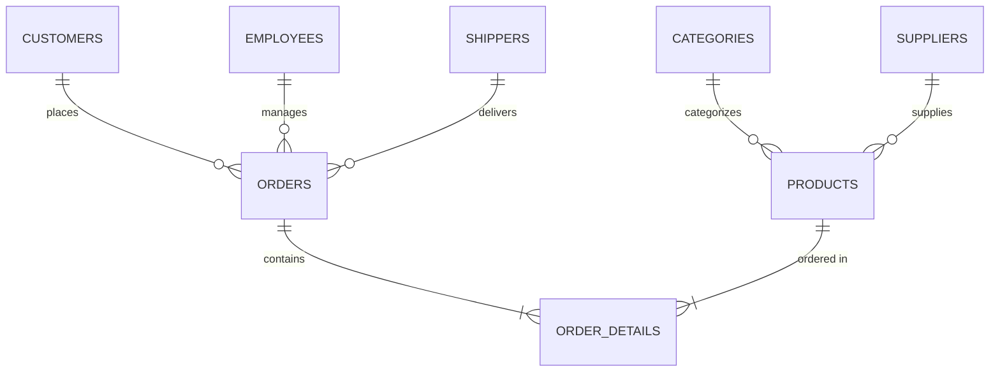

# 🚀 30 Days of SQL: Production-Ready Business Queries

[](https://www.postgresql.org/)
[](https://www.pgadmin.org/)
[](https://opensource.org/licenses/MIT)
[](https://www.linkedin.com/in/omosuyiolawole/)

A hands-on, 30-day technical repository translating realistic retail business scenarios into clean, optimized SQL queries using **PostgreSQL** and **pgAdmin 4**.

---

## 🎯 About This Repository

Most SQL tutorials focus purely on dry syntax. This repository approaches SQL from an **engineering and business analytics perspective**: solving actual fulfillment, accounting, merchandising, and customer retention challenges.

> [!NOTE]
> **A Personal Note: Why I Am Doing This**:  
> As a developer actively learning and strengthening my database engineering foundations, I created this project as a disciplined challenge to deeply understand SQL and PostgreSQL.  
> 
> Rather than just memorizing syntax, I am using this 30-day journey to build practical muscle memory—learning in public, translating messy business requirements into clean queries, and understanding how the PostgreSQL engine works under the hood.

Each challenge corresponds to a daily breakdown shared on LinkedIn under the hashtag **`#30DaysOfSQL`**.

---

## 📂 Repository Layout

```text
30-days-of-sql-challenges/
│
├── database/                   # Database DDL & population scripts
│   ├── 01_schema.sql           # Table DDL & primary/foreign keys
│   └── 02_seed.sql             # 932 records across 8 retail tables
│
├── challenges/                 # Day-by-day challenges & solutions
│   ├── day-01-price-markup/
│   │   ├── README.md           # Business scenario, requirements & takeaways
│   │   └── query.sql           # Commented, production-ready SQL solution
│   ├── day-02-promotional-discounts/
│   │   ├── README.md
│   │   └── query.sql
│   ├── ...
│   └── day-30-market-clusters/
│       ├── README.md
│       └── query.sql
│
├── LICENSE                     # MIT License
└── README.md                   # You are here!
```

---

## ⚡ Quick Start (Setup in Under 2 Minutes)

### Option A: pgAdmin 4 / Local PostgreSQL

1. Open **pgAdmin 4** and connect to your local PostgreSQL server.
2. Right-click **Databases** ➔ **Create** ➔ **Database...** and name it `retail_db`.
3. Open the **Query Tool** on `retail_db`.
4. Execute [`database/01_schema.sql`](./database/01_schema.sql) to create all 8 tables.
5. Execute [`database/02_seed.sql`](./database/02_seed.sql) to populate 932 sample records.

### Option B: Interactive `psql` Terminal / Shell
If you are using the interactive **SQL Shell (`psql`)**, see the comprehensive step-by-step guide:  
👉 **[psql Terminal Execution Guide](./docs/psql-terminal-guide.md)**

### ✅ Expected Verification Output
Once seeded, `02_seed.sql` automatically verifies table integrity and prints the audit summary:

```text
  table_name   | row_count | max_id 
---------------+-----------+--------
 categories    |         8 |      8
 customers     |        91 |     91
 employees     |        10 |     10
 order_details |       518 |    518
 orders        |       196 |  10443
 products      |        77 |     77
 shippers      |         3 |      3
 suppliers     |        29 |     29
(8 rows)
```

---

## 📅 30-Day Challenge Roadmap

| Day | Topic / Challenge | Operator / Concept | Question | Solution | LinkedIn Breakdown |
| :-: | :--- | :--- | :-: | :-: | :-: |
| 01 | Product Logistics Surcharge | `+`, Column Aliasing (`AS`) | [README](./challenges/day-01-price-markup/README.md) | [SQL](./challenges/day-01-price-markup/query.sql) | [View Post](#) |

---

## 🛠 Database Schema & Data Origin

The dataset in this repository is sourced from the classic **W3Schools Northwind Database** ([W3Schools SQL TrySQL Editor](https://www.w3schools.com/sql/trysql.asp?filename=trysql_customers)).

### 💡 Why Clone and Rebuild the Data?

I deliberately cloned this dataset to practice foundational database development from scratch:
- **Hands-On DDL (`CREATE TABLE`)**: Practicing how to design and create tables by myself in PostgreSQL—defining appropriate data types (`SERIAL`, `VARCHAR`, `NUMERIC`, `TIMESTAMPTZ`), establishing primary and foreign key relationships, and writing `CHECK` validation rules.
- **Hands-On DML (`INSERT INTO`)**: Practicing how to insert values and bulk-populate data across normalized tables while respecting relational dependency order.

The sample database represents a retail e-commerce operations backend modeled across 8 normalized tables:



- **`customers`** (91 rows): Customer names, contact details, cities, and countries.
- **`orders`** (196 rows): Order IDs, customer links, employee links, dates, and shipping providers.
- **`order_details`** (518 rows): Order line items linking orders to products with unit quantities.
- **`products`** (77 rows): Product catalog items with unit prices and category/supplier associations.
- **`categories`** (8 rows): Product groupings (Beverages, Confections, Seafood, etc.).
- **`suppliers`** (29 rows): Global vendor contact details and locations.
- **`employees`** (10 rows): Sales and management staff profiles and birthdates.
- **`shippers`** (3 rows): Fulfillment carriers (Speedy Express, United Package, Federal Shipping).

---

## 🤝 Contributing & Community

Whether you're following along with `#30DaysOfSQL` on LinkedIn or improving an existing query:
- Feel free to **fork this repository** and practice your own query optimizations.
- Found a faster way to write a query? Open a **Pull Request**!
- If this repository helped you level up your PostgreSQL skills, please consider giving it a **⭐ Star**!

---

## 👤 Author

- **Author**: **Omosuyi Olawole**
- **LinkedIn**: [linkedin.com/in/omosuyiolawole](https://www.linkedin.com/in/omosuyiolawole/)

---

## 📜 License

This project is licensed under the MIT License — see the [LICENSE](./LICENSE) file for details.
